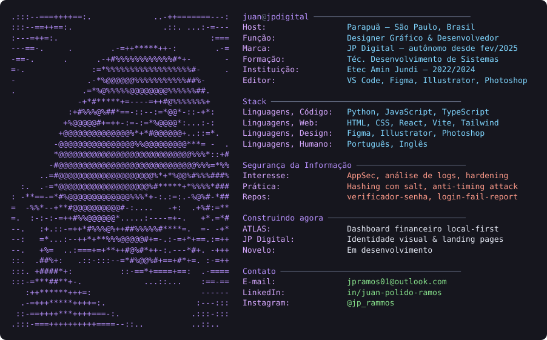

<h1 align="center">Juan Polido Ramos</h1>

  <em>Designer gráfico e desenvolvedor. Marcas que precisam ser vistas, sistemas que não podem ser invadidos.</em>

  

---

### 🧰 Ferramentas

 

---

### 🔐 Segurança da Informação

| Repositório | O que faz |
|---|---|
| [**brute-force-protection-demo**](https://github.com/juanpolido/brute-force-protection-demo) | Verificação de senha com hashing + salt, prevenção de *timing attacks* e contagem de tentativas |
| [**login-fail-report**](https://github.com/juanpolido/login-fail-report) | Analisa logs de falha de login e gera relatórios para SOC |
| [**verificador-senha**](https://github.com/juanpolido/verificador-senha) | Avaliação de força de senha |

### 🎨 Produto & Web

| Repositório | O que faz |
|---|---|
| [**atlas**](https://github.com/juanpolido/atlas) | Dashboard financeiro pessoal — arquivo único, *local-first*, nada sai do navegador |
| [**jp-digital-site**](https://github.com/juanpolido/jp-digital-site) | Landing page institucional da JP Digital — React, TypeScript e Vite |
| [**novelo**](https://github.com/juanpolido/novelo) | Em desenvolvimento |

---

### 📊 Métricas

  
  

  
  
  

<strong>JP Digital</strong> — identidade visual, web e presença digital · Parapuã, SP

